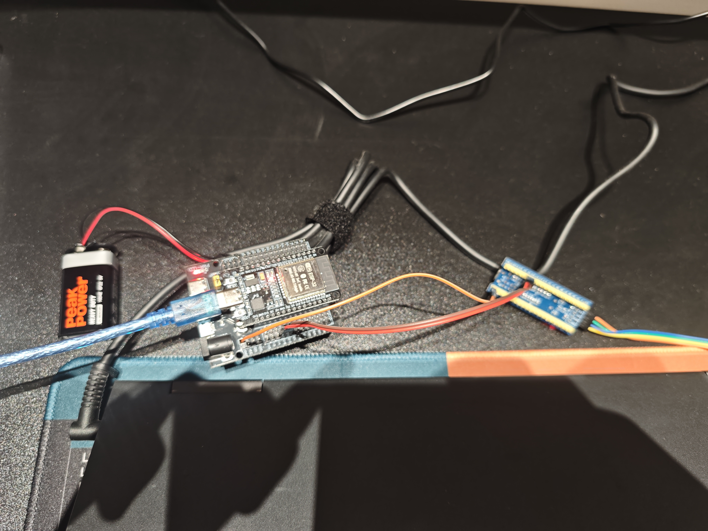

# 🚀 树莓派 5 + ESP32 + STM32 物联网设备控制平台

> **ESP32 无线网关**：连上 WiFi 后订阅树莓派（MQTT Broker）下发的指令，通过 UART 转发给 STM32；再把 STM32 回传的状态发布回 MQTT。**断网时数据落盘 SPIFFS，恢复后自动补发**，实现「云 — 边 — 端」三级无线控制。

[](https://www.espressif.com/)
[](https://www.arduino.cc/en/software)
[](https://github.com/knolleary/pubsubclient)
[](#-断网缓存与非阻塞队列)
[](https://mqtt.org/)
[](LICENSE)

---

## 📖 这是什么

本仓库是三级物联网控制链路中的**中间层（网关层）**固件：

- **边缘层（树莓派 5）**：MQTT Broker + 上位机，跑 Python 脚本或 Node-RED，负责界面、逻辑与数据记录。
- **网关层（ESP32）**：本仓库。连 WiFi → 订阅 MQTT 主题 → 把指令经 **UART** 转给 STM32；把 STM32 回传的数据发布回 MQTT；**网络断开时写入 `/offline.txt`，恢复后补齐**。
- **终端层（STM32F103C8T6）**：硬实时执行器，控制 TB6612 电机、舵机、TCRT5000 安全互锁，回传温湿度与安全状态。

配套仓库：

| 仓库 | 角色 |
| --- | --- |
| [raspberrypi-5](https://github.com/Arduino-STM32-Dev/raspberrypi-5) | 树莓派 5 上位机 / MQTT Broker 环境搭建 |
| **esp32**（本仓库） | ESP32 无线网关：MQTT ↔ UART 双向转发 + 断网缓存 |
| [STM32](https://github.com/Arduino-STM32-Dev/STM32) | STM32F103 执行终端：边缘安全互锁与教程 |

---

## 🎬 先看效果



---

## 🏗️ 系统架构

```text
[树莓派 5 (上位机 / MQTT Broker)]  mosquitto: 0.0.0.0:1883
        ⬆ (WiFi / MQTT)  订阅 pi/to/esp32   发布 home/fan/status
[ESP32 (无线网关)]  std::queue + SPIFFS 断网缓存
        ⬇ (UART 9600, 8N1, RX=16 / TX=17)
[STM32F103C8T6 (执行终端)]  TB6612 电机 / 舵机阀门 / TCRT5000 红外互锁
```

**数据流：** `树莓派 → MQTT(pi/to/esp32) → ESP32 → SerialSTM → STM32 → 执行动作 → 回传 → ESP32 → MQTT(home/fan/status) → 树莓派`

**三个固件版本：**

| 固件 | 定位 | 特点 |
| --- | --- | --- |
| [`firmware/esp32_test`](firmware/esp32_test/esp32_test.ino) | **基础网关**（第一版） | 连接 WiFi / MQTT，指令转发 + 状态上报，逻辑最简单，适合先跑通链路 |
| [`firmware/esp32_fan_gateway`](firmware/esp32_fan_gateway/esp32_fan_gateway.ino) | **简明网关**（早期并行版本） | 与基础版同级的最小实现，配套说明见 [esp32-fan-gateway.md](esp32-fan-gateway.md) |
| [`firmware/cache_control`](firmware/cache_control/cache_control.ino) | **工业级网关**（当前版本） | 在基础版之上增加：**非阻塞队列**、**SPIFFS 断网缓存**、**恢复补发**、**非阻塞重连**、**接收缓冲区扩容** |

---

## 🛠️ 硬件清单

| 硬件名称 | 数量 | 说明 |
| --- | :---: | --- |
| 树莓派 5 (8GB) | 1 | 上位机 + MQTT Broker |
| ESP32 开发板 | 1 | 无线网关（本仓库固件） |
| STM32F103C8T6 (BluePill) | 1 | 执行终端 |
| ST-Link V2 | 1 | STM32 烧录（SWD） |
| USB 转 TTL 模块 | 1 | 调试用 |
| 独立电源（电池盒 / 充电宝） | 2 | ⚠️ ESP32 与 STM32 **各自独立供电** |
| 杜邦线（母对母） | 若干 | 只需 TX / RX / GND 三根 |

> ✅ 实测：ESP32 用**电池 + 外接板**可长期独立运行，固件烧录后无需电脑介入。

---

## 🔌 引脚接线说明

| 设备 A | 设备 B | 说明 |
| --- | --- | --- |
| ESP32 `D17` (TX2) | STM32 `PA10` (RX) | 串口发送：指令下发 |
| ESP32 `D16` (RX2) | STM32 `PA9` (TX) | 串口接收：状态回传 |
| ESP32 `GND` | STM32 `GND` | **共地（必须连接）** |

> ⚠️ **TX 接 RX、RX 接 TX**（交叉接线），且 **ESP32 与 STM32 独立供电，请勿把 VCC 直接互连**。

固件中对应的初始化（[`firmware/cache_control/cache_control.ino`](firmware/cache_control/cache_control.ino#L36-L37)）：

```cpp
SerialSTM.setRxBufferSize(1024);              // ⚠️ 必须在 begin() 之前
SerialSTM.begin(9600, SERIAL_8N1, 16, 17);    // RX=16 ← STM32 PA9(TX) / TX=17 → STM32 PA10(RX)
```

---

## 💻 软件依赖

### 1. 树莓派端（MQTT 服务器）

```bash
sudo apt update
sudo apt install mosquitto mosquitto-clients
# 编辑 /etc/mosquitto/mosquitto.conf，允许外部设备连接：
#   listener 1883 0.0.0.0
#   allow_anonymous true
sudo systemctl restart mosquitto
```

### 2. ESP32 端（Arduino IDE）

| 项目 | 取值 |
| --- | --- |
| 开发板 | `ESP32 Dev Module` |
| 库 | **PubSubClient**（库管理器搜索安装） |
| 文件系统 | **SPIFFS**（ESP32 core 自带） |
| 订阅主题 | `pi/to/esp32` |
| 发布主题 | `home/fan/status` |
| 对 STM32 串口 | `SerialSTM` = UART2，RX `16` / TX `17`，**9600 8N1**，接收缓冲区 `1024` |
| 调试串口 | `Serial` 115200 |

上传前先把 sketch 顶部的三个参数改成你自己的（出于安全考虑，仓库中为占位符）：

```cpp
const char* ssid        = "YOUR_WIFI_SSID";      // 你的 WiFi 名称（必须是 2.4GHz）
const char* password    = "YOUR_WIFI_PASSWORD";  // 你的 WiFi 密码
const char* mqtt_server = "YOUR_PI_IP";          // 树莓派的 IP 地址
```

### 3. STM32 端（Arduino IDE）

| 项目 | 取值 |
| --- | --- |
| 开发板 | `Generic STM32F1 series` → `BluePill F103C8` |
| 上传方式 | `STM32CubeProgrammer (SWD)` / STLink |
| 固件 | [`STM32/firmware/edge_compute`](https://github.com/Arduino-STM32-Dev/STM32)（边缘安全互锁版） |
| 核心功能 | `Serial` 收发（9600）、DHT11 温湿度、TB6612 风扇、舵机阀门、**TCRT5000 红外急停** |
| 上报格式 | `T:25.00,H:60.00,F:0,V:0,S:1` |

---

## 🚦 快速开始（测试指令）

在树莓派终端执行：

```bash
# 开 / 关风扇（TB6612 驱动）
mosquitto_pub -h localhost -t "pi/to/esp32" -m "FAN_ON"
mosquitto_pub -h localhost -t "pi/to/esp32" -m "FAN_OFF"

# 开 / 关阀门（舵机 90° / 0°）
mosquitto_pub -h localhost -t "pi/to/esp32" -m "VALVE_OPEN"
mosquitto_pub -h localhost -t "pi/to/esp32" -m "VALVE_CLOSE"

# 订阅 ESP32 回传的状态
mosquitto_sub -h localhost -t "home/fan/status" -v
```

预期输出：

```text
Received Command from Pi: FAN_ON          ← ESP32 调试串口
收到实时数据: T:25.00,H:60.00,F:1,V:0,S:1  ← ESP32 调试串口
home/fan/status T:25.00,H:60.00,F:1,V:0,S:1 ← 树莓派 mosquitto_sub
```

> 🛡️ **安全优先**：STM32 处于红外警报（`S:0`）时，`FAN_ON` / `VALVE_OPEN` 会被本地互锁**拒绝执行**，而 `FAN_OFF` / `VALVE_CLOSE` 永远有效。

### 断网缓存怎么验证

```text
1) 关掉树莓派（或关热点）  → 串口持续打印 [断网缓存] 队列积压中...
2) 重新打开树莓派          → 打印 发现离线数据，开始补发... / 离线数据补发完成，文件已删除。
3) 树莓派 mosquitto_sub    → 先收到补发的历史行，再收到实时行，一条不漏
```

---

## 📂 仓库目录结构

```text
esp32/
├── README.md                          ← 你正在读的这份文档
├── LICENSE                            ← MIT 许可证
├── .gitignore / .gitattributes
├── esp32-fan-gateway.md               ← 简明网关说明（早期并行版本）
├── firmware/
│   ├── esp32_test/                    ← 基础网关：MQTT ↔ UART 双向转发
│   │   └── esp32_test.ino
│   ├── esp32_fan_gateway/             ← 简明网关（早期并行版本）
│   │   └── esp32_fan_gateway.ino
│   └── cache_control/                 ← 工业级网关：队列 + SPIFFS 断网缓存 + 补发
│       └── cache_control.ino
├── docs/
│   └── 01_OFFLINE_CACHE_AND_QUEUE.md  ← 断网缓存与非阻塞队列（含三大踩坑实录）
└── image-and-video/
    └── esp32-stm32-connect.jpg        ← ESP32 / STM32 接线实拍
```

---

## 🧠 断网缓存与非阻塞队列

完整原理、代码拆解与排错见 **[docs/01_OFFLINE_CACHE_AND_QUEUE.md](docs/01_OFFLINE_CACHE_AND_QUEUE.md)**，这里只放结论：

| 机制 | 解决什么 | 关键代码 |
| --- | --- | --- |
| **非阻塞队列** | `client.publish()` 阻塞时，串口数据被憋丢 | `dataQueue.push(receivedData)` → 之后 `pop()` + `publish()` |
| **接收缓冲区扩容** | 启动 10~15 秒内 256 字节缓冲区溢出 | `SerialSTM.setRxBufferSize(1024)`（必须在 `begin()` 前） |
| **SPIFFS 落盘** | 断网期间数据不丢，重启也不丢 | `SPIFFS.open("/offline.txt", FILE_APPEND)` + `file.println(data)` |
| **`isSyncing` 状态锁** | 补发逻辑被串口数据反复触发 → 无限补发死循环 | `if (... && !isSyncing) { isSyncing = true; ...; isSyncing = false; }` |
| **`close` → `delay(200)` → `remove`** | 句柄未释放导致 `SPIFFS.remove()` 静默失败 | 见 `loop()` 第 4 步 |
| **非阻塞重连** | 旧版 `while(!connected)` 死循环卡死主循环 | `millis()` 节流，每 5 秒试一次 |

> 🔑 **一句话原则**：**串口读取永远是最高优先级，任何可能阻塞的操作（`publish` / 读文件 / 删文件）都不能放在读串口的路径上。**

---

## 🔍 核心实现要点

| 要点 | 说明 |
| --- | --- |
| WiFi 接入 | `setup_wifi()` 阻塞等待 `WL_CONNECTED`，连上后打印 ESP32 的 IP |
| MQTT 连接 | `PubSubClient` + 随机 `clientId`，连接成功后订阅 `pi/to/esp32` |
| 断线重连 | `attemptReconnect()` 用 `millis()` 每 5 秒重试一次，**不阻塞主循环** |
| 指令下发 | `callback()` 把 payload 拼成 `String` 并 `trim()`，用 `SerialSTM.println()` 发出 |
| 串口接收 | `while (SerialSTM.available())` 逐字节拼行，遇 `'\n'` 即入队 |
| 状态上报 | 队列出队后 `client.publish("home/fan/status", data.c_str())` |
| 断网缓存 | 队列非空且离线 → 整队追加写入 `/offline.txt` |
| 恢复补发 | 在线时按行读 `/offline.txt` 逐条 `publish`，`delay(30)` 限速，完成后删除文件 |

> ⚠️ **换行符约定**：ESP32 用 `println()` 发送、STM32 用 `readStringUntil('\n')` 解析；STM32 回传同理。**两端必须成对使用**，否则会读到空串或粘包。

---

## 🚧 常见报错速查

| 报错 / 现象 | 原因 | 解决 |
| --- | --- | --- |
| MQTT 连接失败 `rc=-2` | mosquitto 只监听 `127.0.0.1`，或禁止匿名连接 | 修改 `/etc/mosquitto/mosquitto.conf`：`listener 1883 0.0.0.0` + `allow_anonymous true`，然后 `sudo systemctl restart mosquitto` |
| `rc=-4` | 用户名 / 密码错误 | 确认 `allow_anonymous true`，或补上 MQTT 账号密码 |
| `rc=2` / 一直重连 | `mqtt_server` 填错或树莓派不在同一网段 | `ping` 树莓派 IP；确认 ESP32 与树莓派同一 WiFi |
| WiFi 一直打印 `.` | SSID / 密码填错，或 ESP32 不支持 5GHz | 使用 **2.4GHz** 热点；核对 `ssid` / `password` 大小写 |
| 串口收到乱码 | 两端波特率或数据位不一致 | 两端统一 **9600, 8N1**（波特率改了记得同时改 STM32） |
| 日志无限刷 `发现离线数据，开始补发...` | 补发逻辑写在了串口循环里；或 `remove()` 因句柄未释放而失败 | 补发移到 `loop()` 顶层 + `isSyncing` 状态锁 + `file.close()` 后 `delay(200)` 再 `remove()` |
| 缓存正常，但收不到实时数据 | `publish()` 阻塞撑爆了 256 字节串口硬件缓冲区 | 用 `std::queue` 解耦；`SerialSTM.setRxBufferSize(1024)`（必须在 `begin()` 之前） |
| 联网瞬间刷出 4~5 条同时间戳数据 | 启动 10~15 秒积压，属正常现象 | 扩容缓冲区 + 队列平滑处理；想压低延迟就限制补发速率 |
| `SPIFFS Mount Failed!` | 分区表没给 SPIFFS 留空间 / 文件系统损坏 | 代码已自动 `format()` 兜底；持续失败就选 `Default 4MB with spiffs` 重新烧录 |
| `/offline.txt` 删不掉 | 文件句柄未释放 | `file.close()` 后 `delay(200)` 再 `SPIFFS.remove()` |
| STM32 收不到指令 | TX / RX 未交叉，或**没共地** | 按上表重新接线，**务必连接 GND** |
| 上传后 ESP32 反复重启 | 目标板选错 / 供电不足 | 选 `ESP32 Dev Module`；用独立电源或稳定 USB 口 |
| 树莓派收不到状态 | 订阅主题写错 | 主题核对为 `home/fan/status`，端口 `1883` |

---

## 📚 文档目录

| 篇 | 内容 | 文档 |
| :---: | --- | --- |
| **01** | 非阻塞队列 · SPIFFS 断网缓存 · 恢复补发 · 缓冲区扩容 · 三大踩坑实录 | [📄 断网缓存与非阻塞队列](docs/01_OFFLINE_CACHE_AND_QUEUE.md) |
| — | （早期简明版）MQTT ⇄ UART 网关说明 | [📄 esp32-fan-gateway.md](esp32-fan-gateway.md) |

---

## 📈 后续计划

- [x] 基础网关跑通 MQTT ↔ UART 双向转发
- [x] 非阻塞队列 + 接收缓冲区扩容，解决网络卡顿丢包
- [x] SPIFFS 断网缓存与恢复补发（断网续传）
- [x] MQTT 非阻塞自动重连（`millis()` 节流）
- [ ] WiFi 断开也自动重连（当前只重连 MQTT）
- [ ] 离线文件按天切分 + 缓存条数上限保护
- [ ] 补发改成分批断点续传，支持 JSON 结构化数据
- [ ] 树莓派端开发 Python GUI / Web 界面（或 Node-RED 流程）
- [ ] OTA 远程升级 ESP32 固件

---

## 🤝 贡献与致谢

- 欢迎提交 Issue 反馈问题，或 PR 补充你的踩坑经验。
- 本仓库的组织方式参考了 [STM32](https://github.com/Arduino-STM32-Dev/STM32) 与 [Arduino-Intro](https://github.com/Arduino-STM32-Dev/Arduino-Intro)。

## 📄 许可证

本项目采用 **MIT License**，详见 [LICENSE](LICENSE)。
